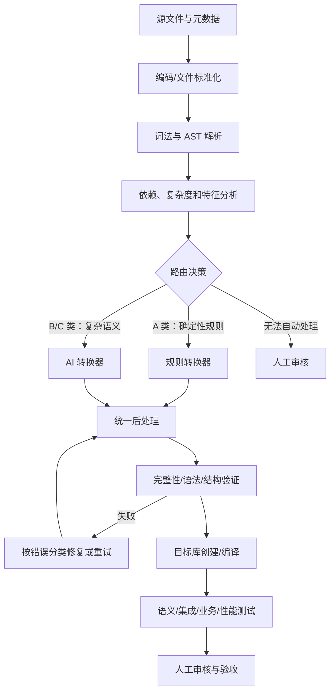

# Oracle → PostgreSQL 完整迁移指导手册

**文档定位：** Oracle PL/SQL → PostgreSQL PL/pgSQL 整体迁移的总体指导大纲，涵盖迁移设计、对象转换规则、程序结构转换、动态 SQL、事务与异常、数据迁移、AI 转换流水线、验证体系及上线回退。  
**适用场景：** GKB 系统 Oracle 数据库对象与 Java/JDBC 应用的整体迁移工程。  
**重要边界：** 本手册是通用工程参考基线，不是对任意系统自动正确性的保证。正式执行前，必须确认 Oracle 源版本、PostgreSQL 目标版本、驱动版本、扩展许可、业务规则和停机窗口。无法证明语义等价的转换必须标记为 `MANUAL_REVIEW` 或 `BLOCKED`，禁止静默猜测。

**核心原则：** 迁移的完成标准不是 SQL 能够编译，而是对象结构、数据语义、事务行为、异常行为和业务结果均得到验证。

**主要依据：**
- [PostgreSQL 官方 PL/pgSQL Oracle 移植指南](https://www.postgresql.org/docs/18/plpgsql-porting.html)
- [PostgreSQL PL/pgSQL 官方文档](https://www.postgresql.org/docs/current/plpgsql.html)
- [AWS Oracle → PostgreSQL 转换限制与 Action Code 索引](https://docs.aws.amazon.com/dms/latest/oracle-to-aurora-postgresql-migration-playbook/chap-oracle-aurora-pg.tools.actioncode.html)

---

## 目录

1. 目标与原则
2. 迁移流程与交付物
3. 转换对象分类（A/B/C/D）
4. 对象转换总表
5. 数据类型映射
6. 表、约束、索引与序列
7. SQL 语法和语义差异
8. PL/SQL → PL/pgSQL 基础规则
9. 嵌套子程序
10. PACKAGE / PACKAGE BODY
11. 游标、动态 SQL 与 DBMS_SQL
12. 集合、批处理与 FORALL
13. 异常与事务
14. 日期、数字、NULL 与字符
15. 触发器、视图、类型及其他对象
16. 权限、安全与外部能力
17. 历史数据迁移
18. Java/JDBC 应用适配
19. AI 转换流水线
20. 分块、依赖与恢复
21. 后处理与自动修复
22. 验证、测试与质量门禁
23. 性能和运维
24. GKB 项目优先级建议
25. 规则库设计
26. 转换示例
27. 上线与回退
28. 风险清单与验收表
29. 官方参考资料

---

# 1. 目标与原则

## 1.1 迁移范围

迁移必须覆盖四个层面：

1. **数据库结构**：Schema、表、字段、类型、约束、索引、序列、视图、触发器、函数、过程、权限等。
2. **程序逻辑**：PL/SQL 控制流、动态 SQL、游标、集合、异常、事务、包状态和外部调用。
3. **历史数据**：全量/增量装载、字符集、日期、精度、LOB、序列校准和业务对账。
4. **应用与运维**：Java/JDBC、SQL 方言、事务控制、连接池、作业调度、监控、备份和回退。

## 1.2 基本原则

- 先盘点、建依赖图，再转换和部署。
- 不以"生成了目标 SQL 文件"作为成功标准。
- 简单、确定的语法优先用规则转换；复杂逻辑使用 AI 辅助并强制验证。
- 不允许 AI 编造源代码不存在的字段、业务规则或异常处理。
- 不允许静默删除无法转换的语句。
- 每个源对象都必须有状态、目标映射、日志和验证证据。
- 转换应可重复、可恢复、可审计；按对象保存检查点。
- 对不确定的语义明确标记 `MANUAL_REVIEW` 或 `BLOCKED`。
- 数据、程序和应用适配要分别验收，最后进行端到端验收。

## 1.3 推荐状态机

`DISCOVERED → ANALYZED → QUEUED → CONVERTING → CONVERTED → VALIDATING → PASSED`

异常状态：`MANUAL_REVIEW`、`BLOCKED`、`FAILED`、`EXCLUDED`。  
`EXCLUDED` 必须有理由、责任人和审批记录。

---

# 2. 迁移流程与交付物

| 阶段 | 主要工作 | 必须交付 |
|---|---|---|
| 0. 环境基线 | 版本、字符集、时区、驱动、扩展、网络和安全确认 | 环境基线表 |
| 1. 资产盘点 | 对象、源文件、数据量、依赖、应用调用盘点 | 对象清单、依赖图 |
| 2. 风险分类 | 复杂度、特征、风险、转换路线 | 风险矩阵、路由报告 |
| 3. 结构转换 | 表、类型、序列、约束、索引、视图 | 目标 DDL |
| 4. 程序转换 | 函数、过程、包、触发器、动态 SQL | 目标源码、映射表 |
| 5. 数据迁移 | 全量/增量、LOB、校验、序列校准 | 数据与对账报告 |
| 6. 应用适配 | JDBC、接口签名、事务、SQL 方言 | 应用改造清单 |
| 7. 验证优化 | 编译、语义、业务、性能、并发、安全 | 测试报告 |
| 8. 切换稳定 | 冻结、最终同步、切换、监控、回退演练 | 切换记录 |

每个对象至少记录：源 Schema、对象类型/名称、源文件、源哈希、依赖、复杂度、风险标签、转换路线、目标名称、转换器/模型版本、尝试次数、验证结果、错误码、人工审核状态、证据路径。

---

# 3. 转换对象分类（A/B/C/D）

按转换难度和所需技术手段，将所有转换对象分为四类，用于路由决策：

## A 类：规则化自动转换

一般 SQL、常规条件判断、循环、简单变量赋值、基础数据类型映射。  
**手段：** 确定性规则转换器。  
**注意：** 仍需语法和语义测试，不能跳过验证步骤。

## B 类：结构重构

嵌套 Function/Procedure、Package/Package Body、Package 全局状态变量、Oracle 特有记录类型、复合类型及调用关系。  
**手段：** 结构分析 + 规则或 AI 辅助；需要建立调用图和变量读写依赖。  
**核心挑战：** PostgreSQL 没有 Oracle Package 原生等价物；PL/pgSQL 不支持本地嵌套子程序声明。

## C 类：语义或机制不兼容

DBMS_SQL（逐列动态处理）、自治事务（`PRAGMA AUTONOMOUS_TRANSACTION`）、事务控制、动态 SQL（动态表名/列名/结果结构）、BULK COLLECT、FORALL（依赖 SAVE EXCEPTIONS）、游标属性（`SQL%ROWCOUNT` 等）、REF CURSOR 生命周期。  
**手段：** 专项规则 + AI 辅助 + 人工审核；无法证明语义等价的必须标记 `BLOCKED`。  
**核心挑战：** 不能通过文本替换实现，需要重新设计数据流或调用接口。

## D 类：数据库和应用架构迁移

表、视图、同义词、序列、触发器、权限、Java/JDBC 调用、历史数据及依赖部署顺序。  
**手段：** 专项迁移工具 + 数据对账 + 应用改造。  
**核心挑战：** 多库、多应用、多环境的协调；回退方案设计。

**路由原则：** 先识别对象类别，再选择转换工具。A 类走规则路径（快、稳）；B/C 类走 AI Agent 路径（带验证）；D 类走专项迁移流程。

---

# 4. 对象转换总表

| Oracle 对象/能力 | PostgreSQL 常见目标 | 类别 | 策略与注意事项 |
|---|---|---|---|
| TABLE | TABLE | D | 类型、默认值、约束、分区和 identity 需验证 |
| INDEX | INDEX | D | 位图、域、反向键、压缩等无普遍一一对应 |
| SEQUENCE | SEQUENCE / identity | D | 数据装载后校准当前值 |
| VIEW | VIEW | D | SQL 改写，按依赖顺序创建 |
| MATERIALIZED VIEW | MATERIALIZED VIEW 或其他方案 | D | 刷新方式、锁、增量刷新需重新设计 |
| PACKAGE / PACKAGE BODY | Schema + 独立函数/过程/类型/表等 | B | 见 §10 详细规则 |
| FUNCTION | FUNCTION | A/B | 返回类型、volatility、异常和权限需验证 |
| PROCEDURE | PROCEDURE 或 FUNCTION | A/B | 依调用方、OUT 参数和事务语义选择 |
| 嵌套 FUNCTION/PROCEDURE | 独立函数，参数显式传递 | B | 见 §9 详细规则 |
| TRIGGER | Trigger + trigger function | D | `:NEW/:OLD`、触发顺序、行/语句级需验证 |
| TYPE | composite / enum / domain / array / 子表等 | B | 根据对象和使用方式逐个设计 |
| SYNONYM | Schema 名称映射或兼容对象 | D | 需修改动态 SQL 和应用引用 |
| DB LINK | `postgres_fdw` / `dblink` / ETL / 服务层 | D | 远程事务和权限不等价 |
| DBMS_SQL | 静态 SQL、动态 SQL、refcursor 或应用层 | C | 见 §11.2 处理矩阵 |
| REF CURSOR | `refcursor` 或应用层结果集 | C | 事务与游标生命周期需集成测试 |
| DBMS_OUTPUT | 日志/诊断输出 | A | 不能当业务结果接口 |
| PRAGMA AUTONOMOUS_TRANSACTION | 独立服务、专用日志机制 | C | 无简单一对一替代 |
| UTL_FILE | 应用文件服务或受控外部服务 | C | 数据库服务端文件权限和安全 |
| DBMS_SCHEDULER / DBMS_JOB | 外部调度器或经批准的扩展 | D | 时区、重试、并发和告警需重新设计 |
| DATA / seed data | COPY / INSERT / ETL | D | 需要完整对账和序列校准 |

---

# 5. 数据类型映射

| Oracle | PostgreSQL 候选 | 风险与验证要求 |
|---|---|---|
| `NUMBER(p,s)` | `numeric(p,s)` | 精度、舍入、溢出 |
| `NUMBER(p,0)` | `smallint` / `integer` / `bigint` / `numeric` | 根据真实范围和应用类型选，不要猜 |
| 无精度 `NUMBER` | 通常先评估 `numeric` | 不要无依据改成浮点 |
| `NUMBER` 范围已确认较小 | `smallint` (≤32767) / `integer` (≤2^31) | 先统计最小最大值 |
| `PLS_INTEGER` / `BINARY_INTEGER` | `integer` | 溢出和运算行为 |
| `BINARY_FLOAT` | `real` | IEEE 浮点语义 |
| `BINARY_DOUBLE` | `double precision` | 精度差异，NaN 比较 |
| `VARCHAR2(n)` | `varchar(n)` / `text` | 字符长度、空字符串、编码 |
| `NVARCHAR2(n)` | `varchar(n)` / `text` | 字符集、排序规则 |
| `CHAR(n)` | `char(n)` / `varchar(n)` | 尾部空格和比较行为 |
| `CLOB` / `NCLOB` | `text` | 大字段、索引、流式访问 |
| `BLOB` | `bytea` 或大对象 | 数据规模和客户端访问模式 |
| `RAW(n)` | `bytea` | 长度和十六进制转换 |
| `LONG` / `LONG RAW` | `text` / `bytea` | Oracle 旧类型需专项处理 |
| `BOOLEAN` | `boolean` | SQL 层与过程语言层使用方式有差异 |
| Oracle `DATE` | `timestamp(0) without time zone` 或 `date` | Oracle DATE 含时分秒，不能一律映射成 date |
| `TIMESTAMP(p)` | `timestamp(p) without time zone` | 精度和舍入 |
| `TIMESTAMP WITH TIME ZONE` | `timestamptz` | 时间点、会话时区和显示格式 |
| `TIMESTAMP WITH LOCAL TIME ZONE` | 专项设计 | 会话时区语义需重建 |
| `INTERVAL` | `interval` | 运算和格式化 |
| `ROWID` / `UROWID` | 主键/业务键 | `ctid` 不应作为稳定业务标识；需设计稳定标识 |
| `BFILE` | 外部路径/对象存储引用 | 不等同普通 BLOB |
| object type | composite / 表结构 / JSONB 等 | 方法、继承、使用模式需评估 |
| VARRAY / nested table | array / 子表 / JSONB | 依据查询、更新和约束选型 |
| Associative Array | 数组（简单）/ 临时表 / JSONB（稀疏/复杂） | 键类型、稀疏索引、遍历顺序需验证 |
| `RECORD`（PL/SQL） | `RECORD` | 字段结构运行时确定，字段访问可能失败 |
| `%TYPE` | 目标对象字段类型或兼容声明 | 依赖创建顺序 |
| `%ROWTYPE` | 目标行类型/复合类型 | 结构变更影响需验证 |

**必须测试的边界：** 最大最小数值、精度/舍入、时区、日期精度、空串、NULL、CHAR 尾部空格、特殊字符、LOB 长度和 JDBC 类型映射。

**重要说明：** 类型名称相似不代表存储范围、精度、空值处理及运算规则完全一致。跨库哈希前必须统一字段格式、NULL 表示、时区、数值 scale 和排序。

---

# 6. 表、约束、索引与序列

## 6.1 表与约束

盘点字段类型、长度、默认值、NULL、主键、唯一约束、外键、检查约束、identity/sequence、分区、临时表、LOB、注释和 Oracle 专有存储属性。不能仅通过替换 `VARCHAR2`、`NUMBER`、`DATE` 来完成 DDL 迁移。

补充约束（从 AWS SCT action code）：

| 特性 | 转换建议 |
|---|---|
| 分区表 | 核对分区键、分区边界、唯一约束及分区裁剪；Oracle 特定分区语法按目标版本重写 |
| 虚拟列（Virtual Column） | 评估生成列、视图表达式或普通列维护逻辑 |
| 函数约束（Function-Based Constraint） | 检查 PostgreSQL 约束表达式限制及索引依赖 |
| 禁用约束/触发器 | 迁移期间和正式运行时的启用状态必须明确 |
| 延迟约束（Deferrable Constraint） | 检查目标版本、事务边界和约束检查时机 |
| Sequence Cache | 检查并发、故障恢复及序列间隙是否影响业务 |

## 6.2 索引

- 普通 B-tree 索引通常容易转换。
- 位图索引、域索引、Oracle Text、反向键、索引压缩和特殊函数索引需设计替代方案。
- 函数基于索引：检查表达式索引及函数的不可变性要求。
- 唯一约束对 NULL 的处理、延迟约束和约束验证状态需按目标版本确认。
- 不要机械复制 Oracle 索引；以 PostgreSQL 查询计划和工作负载重新评估。

## 6.3 序列与 identity

- 搜索所有 `NEXTVAL`、`CURRVAL`、触发器赋值和应用取号逻辑。
- PostgreSQL 使用 `nextval()`、`currval()`、`setval()` 或 identity 列。
- `currval()` 要求当前会话先调用 `nextval()`；不能盲目替换。
- 数据装载后校准序列，覆盖空表、起始值、递增方向、缓存和并发取号。
- 避免应用与触发器重复生成主键。

## 6.4 部署顺序

通常先建角色/Schema、类型/序列、表、索引和约束、函数/过程、视图、触发器、权限和作业，再导入数据、校准序列和更新统计信息。实际执行顺序必须来自依赖图，而不是仅靠固定顺序。

---

# 7. SQL 语法和语义差异

## 7.1 表达函数差异

| Oracle | PostgreSQL 常见改写 | 重点 |
|---|---|---|
| `NVL(a,b)` | `COALESCE(a,b)` | 类型推断和求值语义；验证 NULL 与空串边界 |
| `NVL2(a,b,c)` | `CASE WHEN a IS NOT NULL THEN b ELSE c END` | 返回类型；注意类型推断 |
| `DECODE(...)` | `CASE` | **NULL 匹配行为不同**；Oracle `DECODE(a, NULL, b, c)` 中 a 与 NULL 相等时返回 b，`CASE` 的 `=` 对 NULL 不成立，需用 `CASE WHEN a IS NULL THEN b ELSE c END` |
| `SYSDATE` | `CURRENT_TIMESTAMP` / `LOCALTIMESTAMP` / `CURRENT_DATE` | 先确认需要日期还是时间戳 |
| `SYSTIMESTAMP` | `clock_timestamp()` 或 `CURRENT_TIMESTAMP` | 墙钟时间与事务时间不同 |
| `ROWNUM` | `LIMIT` / `row_number()` / 子查询 | 排序前后语义不同 |
| `DUAL` | 通常省略 `FROM` | 检查依赖 DUAL 的旧查询模式 |
| `MINUS` | `EXCEPT` | 集合语义；重复行处理 |
| `(+)` 外连接 | ANSI `JOIN` | 重写时重点检查外连接过滤条件放在 `WHERE` 还是 `ON`，语义可能差异 |
| `CONNECT BY` | `WITH RECURSIVE` | 层级、循环检测、排序和伪列 |
| `START WITH` | 递归 CTE 初始查询 | 保留根节点选择语义 |
| `PIVOT` / `UNPIVOT` | 聚合、条件聚合或子查询 | 检查动态列需求 |
| `LISTAGG` | `string_agg` | 排序、NULL 和溢出 |
| `REGEXP_LIKE` | `~` / `~*` / 正则函数 | 正则语法差异 |
| `ADD_MONTHS` | `+ interval '1 month'` 等 | **月末行为差异必须测试**：Oracle 对 1月31日 + 1个月 = 2月28/29日，PG 结果需验证 |
| `MONTHS_BETWEEN` | 自定义日期逻辑 | 不可简单按天数换算 |
| `TRUNC(date)` | `date_trunc` 或转成 `date` | 返回类型和截断粒度需确认 |
| `LAST_DAY` | `date_trunc('month', date) + interval '1 month' - interval '1 day'` | 日期边界和返回类型 |
| `ROUND`（数值） | `round(numeric, int)` | 精度、舍入规则（银行家舍入），对边界值需差异测试 |
| `SUBSTR`、`INSTR` 等 | 同名字符函数 | 参数约定和边界不完全一致；多字节字符可能影响长度 |
| `FOR UPDATE WAIT n` | 锁等待策略需重构 | PostgreSQL 无直接等价；用 `SET lock_timeout` 或应用层重试 |
| Oracle SQL Hint | 根据具体优化需求重新设计 | PostgreSQL 不保证接受或执行 Oracle Hint |

## 7.2 高风险语义差异

- Oracle 空字符串通常按 NULL 处理；PostgreSQL `''` 是非 NULL 空字符串。**不能全局替换**，必须按字段级制定策略，统计影响行数。
- Oracle `DATE` 包含时分秒；误映射为 `date` 会丢失时间部分。
- PostgreSQL `CURRENT_TIMESTAMP` 是事务开始时间；`clock_timestamp()` 是实际墙钟时间。
- `SELECT INTO` 在 Oracle 与 PL/pgSQL 中含义不同；PL/pgSQL 创建表应使用 `CREATE TABLE ... AS SELECT`。
- Oracle `SELECT ... INTO` 的无行/多行异常，与 PL/pgSQL 默认 `SELECT INTO` 行为不同；需要时使用 `INTO STRICT`。
- `NOT IN` 遇到 NULL 的三值逻辑必须检查。
- 未指定确定性排序时，不能假设两边结果行顺序一致。
- PostgreSQL 不加双引号的标识符会折叠为小写；建议制定统一命名规范。
- 不要全局用正则删除 `:name`；它可能出现在字符串、注释或其他语法中。
- **NLS 参数：** `NLS_DATE_FORMAT`、`NLS_NUMERIC_CHARACTERS`、`NLS_SORT`/`NLS_COMP` 影响日期解析、字符比较和排序；需检查 collation、大小写及索引行为。

## 7.3 变量名与列名冲突

Oracle 对变量名和列名的解析顺序比 PostgreSQL 宽松，相同代码迁移后可能直接报错。

典型歧义：

```sql
-- Oracle：status 解析为表列，WHERE 中的 status 也是表列（逻辑可能有 bug 但 Oracle 允许）
SELECT status INTO v_status FROM orders WHERE status = status;
```

**推荐转换策略：**
1. 参数统一 `p_` 前缀，局部变量 `v_` 前缀，游标记录 `r_` 前缀。
2. 加表别名消除歧义，SQL 列引用使用别名。

```sql
SELECT o.status INTO v_status FROM orders AS o WHERE o.status = p_status;
```

不要用全局 `plpgsql.variable_conflict` 设置掩盖大量歧义，应在转换阶段逐个消除。

## 7.4 分页（ROWNUM 转 LIMIT/OFFSET）

只有确实表达常规分页语义时，才可改写：

```sql
-- Oracle（需分析 ROWNUM 与 ORDER BY 的相对位置）
SELECT * FROM orders WHERE ROWNUM <= :limit OFFSET :offset;

-- PostgreSQL
SELECT id, created_at FROM orders
ORDER BY created_at DESC, id DESC
LIMIT :limit_value OFFSET :offset_value;
```

**注意：** 嵌套 `ROWNUM`、将 `ROWNUM` 用于业务计算（如 `WHERE ROWNUM = 1` 取第一行）时需专项重写，不能直接套用 `LIMIT 1`。

---

# 8. PL/SQL → PL/pgSQL 基础规则

## 8.1 函数结构差异

| Oracle 特性 | PostgreSQL 对应方式 | 优先级 |
|---|---|---|
| 普通 Function | `CREATE FUNCTION ... RETURNS ...` | A |
| 普通 Procedure | `CREATE PROCEDURE`（PG 11+） | A |
| 嵌套 Function | 无直接等价的局部子程序声明；提为独立函数或内联 | B |
| 嵌套 Procedure | 提为独立 Procedure 或内联；检查参数、事务及异常行为 | B |
| Package Specification | 没有原生 Package；用 schema 组织函数 | B |
| Package Body | 拆分对象，保留公共接口和调用关系 | B |
| Package 全局变量 | 没有原生 Package 级变量；显式参数、临时表或状态表 | B |
| Function 重载 | 支持重载；检查参数类型、默认值及调用解析 | A |
| `OUT` / `IN OUT` 参数 | 支持；结合调用方结果接收方式验证，不能机械替换 | A |
| Oracle `RETURN` 无值退出 | PG Function 必须返回值，Procedure 无返回；分别处理 | A |
| `AUTHID DEFINER` | `SECURITY DEFINER`；检查 `search_path` 和权限 | A |
| `AUTHID CURRENT_USER` | `SECURITY INVOKER` | A |

## 8.2 函数结构转换示例

Oracle：

```sql
CREATE OR REPLACE FUNCTION f_demo(p_id NUMBER)
RETURN NUMBER
IS
  v_count NUMBER;
BEGIN
  SELECT COUNT(*) INTO v_count
  FROM demo_table
  WHERE id = p_id;
  RETURN v_count;
END;
/
```

PostgreSQL：

```sql
CREATE OR REPLACE FUNCTION f_demo(p_id numeric)
RETURNS bigint                -- COUNT(*) 返回 bigint，不是 integer
LANGUAGE plpgsql
AS $$
DECLARE
  v_count bigint;
BEGIN
  SELECT COUNT(*) INTO v_count
  FROM demo_table
  WHERE id = p_id;
  RETURN v_count;
END;
$$;
```

**检查项：** `RETURN` 改为 `RETURNS`；补充 `LANGUAGE plpgsql` 和 `$` 定界符；`IS` 改为 `DECLARE` 块。实际返回类型、参数类型和异常行为必须与接口契约一致。

## 8.3 变量和控制流

- `%TYPE`、`%ROWTYPE` 依赖目标对象，需保证创建顺序。
- 变量名与列名冲突处理见 §7.3。
- `IF/ELSIF/ELSE`、`CASE`、`LOOP`、`WHILE` 可转换，但边界、标签、退出条件、NULL 和异常语义要测试。
- 不要把嵌套 `BEGIN/END` 仅当成字符串计数问题处理。
- Oracle 特有 `PRAGMA`、`GOTO` 等按具体用法重构或标记不支持。
- 避免隐式类型转换，尤其是数字与字符串混用。

## 8.4 SELECT INTO

如果 Oracle 源程序依赖"无行抛出 `NO_DATA_FOUND`、多行抛出 `TOO_MANY_ROWS`"，目标代码需要显式保留：

```sql
-- 要求单行，无行或多行均报错
SELECT col INTO STRICT v_col FROM t WHERE id = p_id;

-- 允许无行（Oracle 默认行为需逐处确认）
BEGIN
  SELECT col INTO v_col FROM t WHERE id = p_id;
EXCEPTION
  WHEN no_data_found THEN
    v_col := default_value;
END;
```

若源逻辑允许无行，则不能无条件加 `STRICT`，应按原行为编写明确的空结果处理。

## 8.5 函数、过程和 volatility

- PostgreSQL 函数声明 `RETURNS`；过程使用 `CREATE PROCEDURE`。
- 过程一般通过 `CALL` 调用；函数通常通过 SQL 表达式或 `SELECT` 调用。
- OUT/IN OUT 参数、结果集和异常需要 JDBC 集成测试。
- `IMMUTABLE`、`STABLE`、`VOLATILE` 必须根据实际副作用和数据依赖声明，不能为了性能猜测。
- `SECURITY DEFINER` 函数需要审查 `search_path` 和权限边界。

---

# 9. 嵌套子程序

**PL/pgSQL 不支持 Oracle 风格的本地嵌套 FUNCTION/PROCEDURE 声明。** 它支持嵌套代码块（`BEGIN ... END`）和局部变量，但这不等于支持嵌套本地子程序。

## 9.1 推荐策略

| 场景 | 推荐方案 | 说明 |
|---|---|---|
| 小型、单次使用子程序，无外部副作用 | **内联** | 直接展开为代码块；必须保留执行顺序和异常边界 |
| 读取外层变量（不修改） | **提为独立函数，外层变量传入** | 把 `v_*` 变量变成函数参数 |
| 修改外层变量 | **提为独立函数，OUT 参数或返回值传递** | 不能直接把 Oracle 局部函数放入 PG `DECLARE` 区域 |
| 多个相关值需整体传递 | 复合类型返回或状态对象 | 避免无必要的全局状态 |
| 递归、游标共享、集合读写、动态 SQL | **人工重构** | 无法可靠自动分析时标记 `MANUAL_REVIEW` |

## 9.2 嵌套子程序转换示例

Oracle：

```sql
FUNCTION outer_func(p_id NUMBER) RETURN NUMBER IS
    v_rate NUMBER := 0.1;

    FUNCTION inner_func(p_value NUMBER) RETURN NUMBER IS
    BEGIN
        RETURN p_value * v_rate;   -- 读取外层变量
    END;
BEGIN
    RETURN inner_func(p_id);
END;
```

**方案一：内联**（逻辑简单时）

```sql
CREATE OR REPLACE FUNCTION outer_func(p_id numeric)
RETURNS numeric
LANGUAGE plpgsql
AS $$
DECLARE
    v_rate numeric := 0.1;
BEGIN
    RETURN p_id * v_rate;
END;
$$;
```

**方案二：提为独立函数**（逻辑复杂时，将外层变量显式传入）

```sql
CREATE OR REPLACE FUNCTION _inner_func(p_rate numeric, p_value numeric)
RETURNS numeric
LANGUAGE plpgsql
AS $$
BEGIN
    RETURN p_value * p_rate;
END;
$$;

CREATE OR REPLACE FUNCTION outer_func(p_id numeric)
RETURNS numeric
LANGUAGE plpgsql
AS $$
DECLARE
    v_rate numeric := 0.1;
BEGIN
    RETURN _inner_func(v_rate, p_id);
END;
$$;
```

**关键原则：** 不要把 Oracle 局部函数声明直接原样放入 PostgreSQL 的 `DECLARE` 区域——PL/pgSQL 不支持此语法。

## 9.3 数据流清单要求

每个嵌套子程序转换前必须建立：
- 读取了哪些外层变量（→ 变成输入参数）
- 修改了哪些外层变量（→ 变成 OUT 参数或返回值）
- 是否递归调用自身
- 是否有游标/集合依赖
- 异常传播路径

**读写集合不明确时标记 `MANUAL_REVIEW`，禁止模型自行假定作用域。**

---

# 10. PACKAGE / PACKAGE BODY

## 10.1 核心限制

PostgreSQL 没有 Oracle PACKAGE / PACKAGE BODY 的原生等价物。通常拆为 Schema 命名空间、独立函数/过程、类型、表或显式状态管理对象。

## 10.2 转换策略（GKB 推荐）

**命名方案：** Package 名 → schema 名或下划线前缀（`schema.pkgname_funcname`）。

Oracle：

```sql
PACKAGE pkg_calc IS
    FUNCTION calc(p_value NUMBER) RETURN NUMBER;
END pkg_calc;
```

PostgreSQL（方案 A：schema 方式）：

```sql
CREATE SCHEMA IF NOT EXISTS pkg_calc;

CREATE OR REPLACE FUNCTION pkg_calc.calc(p_value numeric)
RETURNS numeric
LANGUAGE plpgsql
AS $$
BEGIN
    RETURN p_value * 2;
END;
$$;
```

PostgreSQL（方案 B：下划线前缀方式）：

```sql
CREATE OR REPLACE FUNCTION pkg_calc_calc(p_value numeric)
RETURNS numeric
LANGUAGE plpgsql
AS $$
BEGIN
    RETURN p_value * 2;
END;
$$;
```

选择哪种方案需与 Java 调用层的适配策略一致。原来 `pkg_calc.calc(...)` 的调用形式可能需要改成 `schema.pkg_calc_calc(...)`，需逐处修改。

## 10.3 迁移规则

- Package specification 的公开接口 → 目标函数/过程签名与接口映射表。
- Package body 的实现 → 拆分为独立目标对象。
- 包常量 → 常量表、参数、不可变函数或应用常量，按需求选择。
- 包私有子程序 → 通过命名、Schema 权限和接口约束管理；不能假设 PostgreSQL 有相同的包私有可见性。
- 包初始化代码（`INITIALIZE` 块）→ 显式初始化过程、部署脚本或应用启动逻辑。
- **包级变量和游标 → 必须重构**：独立函数调用间不会自动共享 Oracle package state。

## 10.4 包状态设计选项

| 方案 | 适用场景 | 注意 |
|---|---|---|
| 显式传参/返回状态 | 状态少、调用链清晰 | 优先选择，便于测试 |
| 状态表 | 状态复杂、多调用方共享 | 必须设计会话隔离、并发、清理和事务行为 |
| 应用层请求/会话上下文 | 应用控制事务边界 | 需修改应用 |
| 临时表 | 单次调用内共享 | 生命周期与会话绑定 |

不要用全局表简单模拟包变量而忽略**连接池复用、多用户隔离和事务回滚**。

## 10.5 接口名称映射

原 Java 调用 `KKAPK0030.FCTGetR()`，迁移后可能变成独立函数 `kkapk0030_schema.fct_get_r(...)` 或 `schema.kkapk0030_fct_get_r(...)`。  
命名规则由统一映射表生成，并同步修改 Java、SQL 脚本、作业、动态 SQL 字符串和测试。

---

# 11. 游标、动态 SQL 与 DBMS_SQL

## 11.1 动态 SQL 原则

优先静态 SQL。必须动态执行时：
- **值参数**使用 `USING` 位置参数（`$1`、`$2`...）；
- **动态标识符**（表名、列名）使用 `format('%I', identifier)`；
- 字面值必要时用 `%L`，但优先绑定参数；
- 表名/列名需白名单或权限校验；
- **不允许把未信任输入直接拼进 SQL**；
- 字符串、注释、绑定参数必须由词法/AST 分析，不可盲目正则替换。

**不推荐（字符串拼接）：**

```sql
EXECUTE 'SELECT * FROM orders WHERE order_id = ' || p_order_id;
```

**推荐（绑定参数）：**

```sql
EXECUTE 'SELECT status FROM orders WHERE order_id = $1'
INTO v_status
USING p_order_id;
```

**动态表名（标识符引用）：**

```sql
EXECUTE format(
    'SELECT status FROM %I WHERE order_id = $1',
    p_table_name
)
INTO v_status
USING p_order_id;
```

`%I` 用于标识符，`USING` 用于数据值，不能混用。

## 11.2 DBMS_SQL 处理矩阵

| Oracle 源代码模式 | PostgreSQL 优先方案 | 风险 |
|---|---|---|
| SQL 固定，仅值不同 | 静态 SQL / `EXECUTE ... USING` | 低 |
| 动态表名/列名，结果结构固定 | `format('%I', ident)` + `EXECUTE` | 中 |
| 动态 SQL，返回结构固定 | `EXECUTE ... INTO` 或 refcursor | 中 |
| 返回列结构运行时才确定 | 应用层结果集、JSON、临时结果表或新接口 | 高 |
| `DBMS_SQL.DEFINE_COLUMN` + `COLUMN_VALUE` 逐列处理 | 重构结果消费协议，通常需应用层接管 | 高 |
| 动态 DDL | 单独审查权限、注入和事务限制 | 高 |
| 游标传入其他子程序（跨过程） | 先建立跨过程调用关系，再设计 PG 游标接口 | 极高 |

`DBMS_SQL` **不是简单的 `EXECUTE IMMEDIATE` 文本替换**。必须先识别具体 API 序列和数据流。

**GKB 处理策略：** 对每个 `DBMS_SQL` 调用链建立结构化生命周期记录：

```
cursor_id
  ├─ OPEN_CURSOR
  ├─ PARSE (SQL text)
  ├─ BIND_VARIABLE (name, value)
  ├─ DEFINE_COLUMN (n, type)
  ├─ EXECUTE
  ├─ FETCH_ROWS
  ├─ COLUMN_VALUE(n, col)
  └─ CLOSE_CURSOR
```

识别完整生命周期后决定转换方案：
- 固定查询结构：静态 SQL 或参数化动态 SQL
- 动态表名/列结构固定：安全标识符拼接 + 绑定参数
- 动态列数或动态列类型：复合类型、JSON、临时表或应用层
- 游标被传给其他子程序：先建调用关系图，再设计 PG 游标接口

## 11.3 REF CURSOR

- PostgreSQL `refcursor` 的生命周期受**事务/会话**影响（事务结束游标失效）。
- 测试 JDBC `CallableStatement`、自动提交、结果集读取、连接池和事务提交时机。
- 动态列结构往往更适合应用层处理。
- 明确谁负责打开、读取和关闭游标；在连接池环境下尤其重要。

## 11.4 DBMS_OUTPUT

开发诊断改为应用日志、数据库日志或 `RAISE NOTICE`。  
**不能将 NOTICE 当作业务结果**，也不能依赖客户端是否启用输出决定业务逻辑。

## 11.5 游标属性映射

| Oracle 游标属性 | PostgreSQL 对应 | 注意 |
|---|---|---|
| 显式 `CURSOR ... LOOP` | PL/pgSQL 显式游标或 `FOR ... IN SELECT` | 循环变量声明规则不同 |
| 隐式 Cursor | SQL 语句结果 | `SQL%ROWCOUNT` 等属性需单独映射 |
| `SQL%ROWCOUNT` | `GET DIAGNOSTICS v_count := ROW_COUNT` | **必须紧跟目标语句**，后续 SQL 会覆盖 |
| `SQL%FOUND` / `SQL%NOTFOUND` | 检查结果或 `FOUND` 诊断信息 | 确认具体语句执行后的状态 |
| `SQL%ISOPEN` | 无通用隐式接口 | 按具体游标模型重构 |
| 参数化游标 | 带参数的查询或显式游标 | 检查参数传递及查询生命周期 |
| `CURSOR FOR` Loop | `FOR record IN SELECT ... LOOP` | 循环变量类型需显式声明 |

**`SQL%ROWCOUNT` 转换示例：**

```sql
-- Oracle
UPDATE orders SET status = 'DONE' WHERE order_id = p_order_id;
IF SQL%ROWCOUNT = 0 THEN
    NULL;
END IF;

-- PostgreSQL
DECLARE
  v_row_count integer;
BEGIN
  UPDATE orders SET status = 'DONE' WHERE order_id = p_order_id;
  GET DIAGNOSTICS v_row_count := ROW_COUNT;
  IF v_row_count = 0 THEN
    NULL;
  END IF;
END;
```

---

# 12. 集合、批处理与 FORALL

## 12.1 集合类型选择

Oracle associative array、nested table、VARRAY 与 PostgreSQL 对应物并非完全等价。选择方案时检查稀疏下标、`FIRST/LAST/NEXT/PRIOR/COUNT/DELETE`、元素结构、SQL 查询能力和约束要求。

| 场景 | 推荐方案 |
|---|---|
| 简单同类型列表，无稀疏下标 | PostgreSQL array |
| 大量数据、集合运算、SQL JOIN | 临时表或 staging table |
| 单条结构化记录 | 复合类型（composite） |
| 长期业务集合 | 关系表 |
| 稀疏数组、字符串键 | JSONB 或映射表 |

## 12.2 BULK COLLECT

`BULK COLLECT` 可考虑：
- `FOR record IN EXECUTE(...)` 逐行读取
- 数组 + `foreach` 循环
- 直接 `INSERT ... SELECT`（避免客户端数组）

**不能将 `BULK COLLECT` 直接改成逐行 `LOOP` 而忽略性能**，应评估数据量后选择。

## 12.3 FORALL

`FORALL` 可考虑：
- 集合化 DML：`UPDATE ... FROM`、`INSERT ... SELECT`
- 参数化 `EXECUTE` + 批量

**FORALL 不能一律转成循环。** Oracle 的批处理语义（一次性执行、减少上下文切换）用逐行 `LOOP` 替代可能产生重大性能差异。

```sql
-- 集合化改写（推荐，当允许无 SAVE EXCEPTIONS 时）
UPDATE orders AS o
SET status = s.status
FROM staging_orders AS s
WHERE o.order_id = s.order_id;
```

**需要保留逐行处理的情况：** Oracle 代码依赖 `SAVE EXCEPTIONS`、每行独立错误记录、批次执行顺序或部分成功后继续处理——此时需要设计逐行处理或批次错误收集机制，并通过测试确认。

## 12.4 SAVE EXCEPTIONS

`SAVE EXCEPTIONS`、`SQL%BULK_ROWCOUNT`、`SQL%BULK_EXCEPTIONS` 需要建立对应的错误和行数处理机制。PostgreSQL 没有直接等价物，常见方案：
- 逐行执行 + 异常收集（错误日志表）
- 批量执行 + 单独验证 + 失败行重试

---

# 13. 异常与事务

## 13.1 异常映射

| Oracle | PostgreSQL 处理 |
|---|---|
| `NO_DATA_FOUND` | 同名异常或显式空结果处理（`no_data_found`） |
| `TOO_MANY_ROWS` | 同名异常；必要时 `SELECT ... INTO STRICT` |
| `DUP_VAL_ON_INDEX` | `unique_violation`；必要时检查约束名 |
| `INVALID_NUMBER` | `invalid_text_representation` |
| `SUBSCRIPT_OUT_OF_RANGE` | 无同名异常；数组越界抛出 PG 自身错误 |
| `SQLCODE` | `SQLSTATE` / `GET STACKED DIAGNOSTICS x = RETURNED_SQLSTATE` |
| `SQLERRM` | `SQLERRM` / `GET STACKED DIAGNOSTICS x := MESSAGE_TEXT` |
| `RAISE_APPLICATION_ERROR` | `RAISE EXCEPTION ... USING ERRCODE, MESSAGE` |
| `WHEN OTHERS` | 可使用，但**必须明确记录、恢复或重新抛出**，不得静默吞掉 |
| 自定义 Exception | 自定义 SQLSTATE 或条件映射 |

示例：

```sql
BEGIN
  -- business logic
EXCEPTION
  WHEN unique_violation THEN
    -- 具体处理
    RAISE;
  WHEN OTHERS THEN
    GET STACKED DIAGNOSTICS
      v_state   := RETURNED_SQLSTATE,
      v_message := MESSAGE_TEXT;
    RAISE;   -- 重新抛出，不得静默吞掉
END;
```

**禁止为了"让程序通过"而把所有异常吞掉、返回 NULL 或假装成功。**

## 13.2 事务语义

| Oracle 特性 | PostgreSQL 处理方向 | 注意 |
|---|---|---|
| `COMMIT` / `ROLLBACK` | 顶层 Procedure 或 `DO` 调用链中使用 | Function 内不能直接结束事务 |
| `SAVEPOINT` / `ROLLBACK TO` | 异常块子事务机制 | PG 不支持在过程代码中直接使用保存点命令 |
| 自治事务（`PRAGMA AUTONOMOUS_TRANSACTION`） | 独立连接/服务、专用日志机制 | **无直接等价物，需重新设计** |
| `DBMS_LOCK` | PostgreSQL advisory lock（`pg_advisory_lock`） | 锁粒度、释放和并发行为不同 |
| `DBMS_TRANSACTION` | PostgreSQL 事务函数 | 逐项分析，不能整体替换 |
| 死锁/锁超时异常 | SQLSTATE 映射；重试范围需验证 | 幂等性需测试 |

## 13.3 自治事务是高风险项（C 类）

典型用途：业务操作失败时仍要写错误日志、审计记录或独立提交某项状态。

**不能删除 `PRAGMA AUTONOMOUS_TRANSACTION` 后认为转换完成**，原有日志可能从"独立提交"变成"随外层事务一起回滚"。

转换前需明确：
- 哪些数据需要独立提交？
- 外层事务回滚时，哪些日志必须保留？
- 独立操作是否会读取或修改外层事务正在操作的数据？
- 调用方是否依赖原来的提交时机？

可选方案：
1. 独立数据库连接/服务执行日志写入
2. 专用日志表 + 独立 `DO` 块
3. 应用层异步日志
4. `LISTEN/NOTIFY` + 独立消费者

不同方案的一致性与故障行为并不相同，需逐一评估。

---

# 14. 日期、数字、NULL 与字符

| 主题 | 行为差异 | 转换策略 |
|---|---|---|
| 空字符串 | Oracle：`''` = `NULL`；PG：`''` ≠ `NULL` | **不能全局替换**；按字段级制定策略，统计影响行数后决定 |
| Oracle `DATE` | 含时分秒；PG `date` 不含 | 确认目标字段是否需要 `timestamp`；先检查数据样本 |
| `ADD_MONTHS` | 月末日期处理有差异 | 月末、闰年、负月份单独测试 |
| `SYSDATE`/`SYSTIMESTAMP` | 时间语义不同 | 先确认需要的是事务时间还是墙钟时间 |
| 隐式类型转换 | PG 更严格，运算/比较/重载选择可能不同 | 将关键转换显式化 |
| 字符集/排序 | `NLS_SORT`/`NLS_COMP` 影响比较和索引 | 检查 collation、大小写及索引行为 |
| 字符长度语义 | 多字节字符可能影响 `LENGTH`/`SUBSTR` | 验证字符数 vs 字节数的业务需求 |
| `TRUNC(date)` | 截断粒度不同 | 明确要截断到日、月还是其他粒度 |
| `ROUND`/`TRUNC`（数值） | 舍入规则不同（银行家舍入 vs 四舍五入） | 对边界值做差异测试 |
| 全半角/特殊符号 | 字符集编码差异 | 检查 Unicode 映射和文件编码 |
| 文件编码 | CP932/Shift_JIS 等 | 显式识别编码、BOM 和换行，不能一律按 UTF-8 读取 |

**建议至少覆盖：** 月末、闰日、时区跨日、负数、精度边界、空值和空字符串，不要只测普通样本。

---

# 15. 触发器、视图、类型及其他对象

## 15.1 触发器转换

PostgreSQL 触发器需要**先创建 trigger function，再创建 trigger**，结构与 Oracle 不同：

Oracle：

```sql
CREATE TRIGGER trg_orders BEFORE INSERT ON orders
  FOR EACH ROW
BEGIN
  :new.created_at := SYSDATE;
END;
```

PostgreSQL：

```sql
CREATE OR REPLACE FUNCTION fn_trg_orders()
RETURNS trigger
LANGUAGE plpgsql
AS $$
BEGIN
  NEW.created_at := CURRENT_TIMESTAMP;
  RETURN NEW;
END;
$$;

CREATE TRIGGER trg_orders
BEFORE INSERT ON orders
FOR EACH ROW
EXECUTE FUNCTION fn_trg_orders();
```

**至少检查：**
- `BEFORE` / `AFTER` / `INSTEAD OF` 触发时机
- 行级（`FOR EACH ROW`）与语句级（`FOR EACH STATEMENT`）差异
- `:NEW`/`:OLD` → `NEW`/`OLD`；`TG_OP` 判断操作类型
- **多行 DML 时行级触发器执行次数**（每次 DML 一行触发一次，可能性能差异）
- 触发器之间的调用顺序和相互引用
- 递归触发（`pg_trigger_depth()` 限制）
- 触发器内异常处理和事务副作用
- **不能只做 `:NEW.col` → `NEW.col` 的文本替换**

## 15.2 视图和物化视图

- 解析列、表达式、连接、聚合、窗口函数和依赖
- 检查可更新视图、权限、列名、检查选项（`WITH CHECK OPTION`）和 Oracle 专有 SQL
- 物化视图刷新频率、并发和增量刷新能力需重新设计
- PostgreSQL `REFRESH MATERIALIZED VIEW CONCURRENTLY` 要求视图有唯一索引，按目标版本验证

## 15.3 TYPE

根据真实用法选择：

| Oracle TYPE | PG 方案 | 注意 |
|---|---|---|
| 简单记录类型 | `composite type` 或行构造器 | 字段顺序和类型需匹配 |
| 枚举类（限制值） | `CREATE TYPE ... AS ENUM` | 有序性检查 |
| 带校验范围 | `CREATE DOMAIN` | 约束行为 |
| 对象类型（带方法） | composite + 独立函数 / 表结构 | 方法需逐个提为函数 |
| VARRAY | PostgreSQL array | 上限、SQL 查询能力 |
| Nested Table | 子表 / JSONB / 临时表 | 按业务场景选 |

若类型包含方法、继承、集合行为或被多个包广泛引用，必须先建立依赖图和接口兼容策略。

## 15.4 同义词、DB LINK 和外部能力

- **SYNONYM**：建立名称映射并检查动态 SQL、应用 SQL 和权限。
- **DB LINK**：评估 `postgres_fdw`、`dblink`、ETL 或服务层；验证事务、凭证、超时和重试。
- **UTL_FILE**：优先受控应用文件服务；检查文件权限、路径和安全边界。
- **DBMS_SCHEDULER / DBMS_JOB**：外部调度器或经批准的扩展；重建时区、重试、并发策略。
- **UTL_HTTP**：应用 HTTP 客户端或安全审核过的扩展。
- **DBMS_LOB**：根据 `text`、`bytea` 和流式访问方式逐个设计。
- **Oracle Text / Spatial / XMLType / AQ**：单独评估 PG 扩展（`tsvector`、PostGIS 等）或外部服务，不假设直接等价。

---

# 16. 权限、安全与外部能力

- 盘点用户、角色、系统权限、对象权限、同义词和授权链。
- 区分应用账号、迁移账号、只读账号和运维账号；坚持最小权限。
- 不要将 Oracle DBA 粗略映射为 PostgreSQL 超级用户。
- 检查数据库、Schema、表、序列、函数和过程的权限及默认权限。
- 审核 `search_path`（防对象名解析到错误 schema）、`SECURITY DEFINER`、动态 SQL 和 SQL 注入。
- 不得把密码、连接串、令牌或敏感业务数据写入 AI prompt 或日志。
- 验证审计、脱敏和访问控制。
- **`search_path` 是高风险项**：未限定的对象名解析可能因 schema 顺序变化导致指向错误对象，必须在所有函数和触发器中显式限定。

---

# 17. 历史数据迁移

## 17.1 迁移策略

依据数据量、变更频率、网络和停机窗口选择：
- 停机全量（数据量小、窗口允许）
- 全量 + 增量同步（数据量大、有变更）
- 分批迁移（特定分区或时间范围）

工具选择需结合版本、权限、许可、安全和一致性要求。

## 17.2 推荐步骤

1. 盘点表、分区、行数、LOB、约束和数据增长
2. 明确类型、字符集、时区、NULL/空串和舍入策略
3. 创建目标结构
4. 按可恢复批次装载全量数据
5. 若需要，执行增量同步并记录截止点
6. 对账并处理差异
7. 重建/验证索引和约束
8. 校准序列/identity
9. 更新统计信息并进行性能验证
10. 执行最终同步、切换和切换后对账

## 17.3 最低对账项

- 每表总行数
- 按主键范围/分区分桶的行数
- 主键缺失、重复和外键关系完整性
- NULL、空字符串、特殊字符、最大/最小值
- 金额、数量、日期和状态的业务汇总
- LOB 长度或摘要
- 关键业务查询结果
- 抽样差异报告
- 序列当前值和下一次取号安全性

只比较总行数不够。跨库哈希前必须统一字段格式、NULL 表示、时区、数值 scale 和排序。

## 17.4 隐蔽问题清单

| 风险 | 需采取措施 |
|---|---|
| `NUMBER` 到整数类型 | 先统计范围、精度和溢出风险 |
| `DATE` → `date` | 检查时分秒是否丢失；必要时用 `timestamp(0)` |
| 空字符串和 NULL | 明确数据转换规则，统计影响行数 |
| 字符集和排序规则 | 检查特殊字符、日文字符及比较结果 |
| LOB 数据 | 核对长度、二进制内容及完整性 |
| 主键与唯一约束 | 在目标端验证重复数据和约束冲突 |
| 外键与加载顺序 | 确定父子表依赖和约束启用策略 |
| 序列与 identity | 历史数据装载后校正下一个生成值 |
| 默认值 | 检查 Oracle 函数、序列及目标端默认表达式 |
| 时区 | 检查存储值、会话时区和应用展示结果 |
| 迁移期间的增量变更 | 制定一致性检查点和增量方案 |
| 大批量导入 | 检查事务大小、索引维护、锁和失败重试 |

**建议的数据验证记录格式：**

```text
table_name
source_row_count
target_row_count
source_checksum_or_aggregates
target_checksum_or_aggregates
constraint_failures
conversion_exceptions
verification_status
```

校验和计算必须考虑目标类型和编码变化；直接比较原始字节校验值，可能因格式差异产生无意义差异。

---

# 18. Java/JDBC 应用适配

逐项检查：

- **SQL 方言**：分页算法、`ROWNUM`、序列取号、日期函数
- **`CallableStatement`**：函数与 Procedure 的调用方式不同（`?={call func(?), ?}` vs `{call proc(?)}`）；OUT 参数、refcursor 的接收方式
- **Oracle 专有驱动类**：`oracle.sql.*`、`oracle.jdbc.*`、`oracle.net.*` 需替换为 PG JDBC 驱动
- **类型映射**：`NUMBER` → `BigDecimal` 或整数；Oracle DATE → Java `Timestamp`（含时分秒）
- **空字符串与 NULL**：`getString()` 对 NULL 返回 `null`，对 `''` 返回 `""`，Oracle 和 PG 行为有差异
- **自动提交、事务隔离**：连接池配置、锁等待、死锁与重试策略
- **批量 DML**：Oracle `addBatch` 批量大小、错误处理 vs PG 批量行为
- **CLOB/BLOB**：流式读写接口差异
- **标识符大小写**：Java 中的大写对象名需确认 PG 端命名
- **ORM 方言**：主键生成策略（sequence vs identity）、分页方言、迁移脚本
- **动态 SQL 中的 package/function 名称**：字符串内嵌的 `pkg_name.func_name(...)` 需全部定位并修改

为每个数据库接口建立契约：名称、参数顺序/类型、返回类型、异常 SQLSTATE、事务要求、结果集列、调用样例和兼容版本。

**注意**：AWS 迁移指南明确指出应用层适配是独立工作，不只是转换数据库代码。Oracle 专属错误码需要建立 PostgreSQL SQLSTATE 到业务异常的映射。

---

# 19. AI 转换流水线

## 19.1 架构



## 19.2 AI 的职责边界

AI 可辅助：复杂逻辑改写、重构建议、测试用例生成、错误分析。  
AI **不能**单独保证：对象完整性、数据对账、语法最终正确、业务等价、上线批准。  
所有 AI 输出必须经过工具验证和目标数据库实测。

## 19.3 路由特征清单

除复杂度分数外，为每个源对象记录显式特征标记：

```
HAS_DBMS_SQL
HAS_DYNAMIC_SQL
HAS_REF_CURSOR
HAS_NESTED_SUBPROGRAM     ← B 类（结构重构）
HAS_PACKAGE_STATE
HAS_AUTONOMOUS_TRANSACTION  ← C 类（语义不兼容）
HAS_COLLECTION
HAS_BULK_DML
HAS_EXTERNAL_IO
HAS_DDL
HAS_EXCEPTION_SWALLOWING
HAS_DYNAMIC_RESULT_SHAPE  ← 高风险，单独审核
HAS_CROSS_OBJECT_DEPENDENCY
```

动态结果结构、自治事务、包状态、外部 I/O 和复杂 DBMS_SQL 应触发高风险审核，不应只靠复杂度阈值。

## 19.4 Feature Manifest（每对象）

在调用 AI 前，先生成结构化分析结果：

```json
{
  "object_name": "GKB_SAMPLE_PKG",
  "object_type": "PACKAGE_BODY",
  "source_file": "sql/GKB_SAMPLE_PKG.pkb",
  "source_hash": "sha256:abc123...",
  "line_count": 4200,
  "complexity_score": 0.78,
  "category": "C",
  "features": [
    "NESTED_SUBPROGRAM",
    "DBMS_SQL",
    "EXECUTE_IMMEDIATE",
    "REF_CURSOR",
    "AUTONOMOUS_TRANSACTION",
    "SAVE_EXCEPTIONS"
  ],
  "nested_subprograms": [
    {"name": "inner_calc", "line_start": 120, "line_end": 340, "reads": ["v_total"], "writes": ["v_result"]}
  ],
  "external_dependencies": ["GKB_TABLE_A", "GKB_SEQ_B"],
  "package_state_references": ["g_total", "g_last_update"],
  "dynamic_sql_sites": [
    {"line": 880, "sql_pattern": "DYNAMIC_TABLE", "result_shape": "DYNAMIC"}
  ],
  "transaction_features": [
    {"line": 1200, "type": "AUTONOMOUS_TRANSACTION", "purpose": "error_log"}
  ],
  "conversion_strategy": "AI_WITH_SPECIALIZED_RULES",
  "feature_detection_status": {
    "NESTED_SUBPROGRAM": "DETECTED",
    "DBMS_SQL": "DETECTED",
    "AUTONOMOUS_TRANSACTION": "DETECTED",
    "PACKAGE_INITIALIZE": "NOT_DETECTED",
    "TRIGGER_DEPENDENCY": "UNKNOWN"
  }
}
```

**关键原则：分析器没有识别出的特征，不能被当成不存在。** 应为每个特征增加 `DETECTED`、`NOT_DETECTED`、`UNKNOWN` 状态，`UNKNOWN` 作为验证或人工复核事项。

## 19.5 可追溯性（每次转换）

每次转换保存：
- 源哈希（防输入变化）
- 规则版本 + prompt 版本 + 模型及参数
- 输入上下文（Feature Manifest）
- AI 原始输出
- 后处理 diff
- 尝试次数
- 验证证据（语法检查、对象数核对、测试结果）

源码和解释文本必须分离。模型无法确认时，输出结构化未解决项，不允许编造。

---

# 20. 分块、依赖与恢复

## 20.1 分块规则

- **优先按完整对象转换**，不得按固定字符数直接切断 PL/SQL。
- 超大对象先做词法/AST 边界识别，再根据调用图和共享状态切分。
- **不能用简单正则或 `BEGIN/END` 字符计数判断嵌套边界**（当前 P4-2f 任务正在处理的问题）。
- 每块保留：package spec、相关类型、共享变量、调用图、相关表结构和业务约束。
- 每块有 ID、源范围、依赖、预期对象数和完整性检查。

## 20.2 大型 PACKAGE BODY 处理（>2000 行）

1. 解析包内函数/过程清单
2. 构建调用图和变量读写依赖
3. 标记包级状态、常量、游标和异常
4. 先建立目标接口与命名映射
5. 转换独立子程序（无外部依赖的优先）
6. 处理共享状态、递归和跨程序调用
7. 组合并部署目标对象
8. 编译整个依赖闭包
9. 运行包级业务测试

## 20.3 检查点和重试

按对象独立保存检查点。错误分类：

| 错误类型 | 处理方式 |
|---|---|
| 输出格式错误（缺 `$$`、多余文本） | 后处理修复 |
| 对象截断（不完整） | 重新生成 |
| 语法错误 | 修复后重试 |
| 依赖缺失（引用未转换对象） | 先转换依赖，再重试 |
| 语义不确定 | 转人工审核 |
| 目标库编译失败 | 分析错误，修 SQL |
| 测试失败 | 根据失败用例调整逻辑 |
| 环境故障 | 记录日志，等环境恢复 |

重试达到上限（建议 3 次）后转人工审核/阻塞。源哈希或规则版本变化时必须重新验证。

---

# 21. 后处理与自动修复

## 21.1 必检项

对每个转换结果执行：

- 是否混入 Markdown、解释或思考文本（AI 常见输出污染）
- 目标对象数量是否符合源清单（**对象数缺失即判 fail**）
- `LANGUAGE plpgsql` 是否存在于正确位置
- dollar-quote（`$$`）标签是否成对
- 程序体、异常分支和返回值是否完整
- 源子程序是否都有映射（对照 Feature Manifest）
- Oracle 专有语法是否残留（完整列表见 DoD-2 / 残留扫描器）
- `:param` 是否为真正未转换的绑定变量（需词法分析，不能正则判断）
- 是否有悬空引用、缺失对象或截断
- 字符串和注释是否被误改（内容保持）

## 21.2 禁止的粗暴修复

- 无条件给每个对象追加 `LANGUAGE plpgsql`（会破坏 SQL 函数声明）
- 全局正则删除 `:\w+`（会破坏字符串内容、列名、注释）
- 通过增加/删除 `END` 使文本表面平衡（掩盖真正的语法错误）
- 删除无法识别的 SQL（数据丢失）
- 把所有异常改为 `WHEN OTHERS THEN NULL`（静默吞错）
- 不分析语义就统一替换日期函数或类型
- 把 AI 解释文本当作源码

**后处理只做有明确证据的结构修复，并保留原始输出、diff 和验证结果。**

---

# 22. 验证、测试与质量门禁

## 22.1 七层验证

| 层级 | 内容 | 检测目标 |
|---|---|---|
| L1 文件完整性 | 输出文件数、编码、对象数、`LANGUAGE plpgsql` | AI 只返回半个 Function，对象缺失 |
| L2 语法/编译 | DDL 语法、`$$` 配对、函数体结构 | 缺少 `$$` 或函数无法创建 |
| L3 结构完整性 | 源子程序数、参数、变量、异常分支是否完整 | 嵌套 Function 丢失，参数签名错误 |
| L4 依赖完整性 | 调用目标、表、视图、类型、序列是否存在 | Package 调用指向不存在的函数 |
| L5 语义一致性 | 返回值、空值、事务、异常、游标行为 | 异常块回滚行为改变 |
| L6 业务回归 | 相同输入下的业务输出和 DB 副作用 | 编译成功但金额计算不同 |
| L7 性能与并发 | 执行时间、锁等待、批量性能 | 原批量 DML 变成低效逐行 |

## 22.2 测试种类

- **单元**：输入/输出、边界、异常
- **组件**：跨函数/过程、触发器和事务
- **集成**：Java/JDBC、连接池、作业和外部系统
- **数据**：行数、聚合、字段、关联完整性
- **性能**：延迟、吞吐、执行计划、CPU/I/O、锁等待
- **并发**：竞争更新、唯一冲突、死锁、重试、幂等
- **故障**：连接中断、超时、部分失败、恢复
- **安全**：权限、SQL 注入、`search_path`、敏感日志
- **回退**：恢复服务与数据一致性演练

## 22.3 转换覆盖率指标

**转换覆盖率** = `已处理且已验证的源特征数 ÷ 识别出的源特征总数 × 100%`

此指标不能替代语义测试，但能防止系统只统计"生成了多少个 SQL 文件"而忽略原有业务特征是否被完整处理。每个特征（Feature）都有 `DETECTED / NOT_DETECTED / UNKNOWN` 状态，`UNKNOWN` 特征不能算入已覆盖数。

## 22.4 质量门禁

以下任一情况**阻塞发布**：
- 对象缺失（**对象数缺失即判 fail**）
- 语法/编译失败
- 未解析依赖
- 有未处理占位符或 AI 未解决项
- 核心业务测试失败
- 数据对账失败
- 高风险对象无人审核
- 安全或回退演练未完成

平均通过率不能覆盖关键对象失败；高风险对象（C 类）应逐个验收。

---

# 23. 性能和运维

- 对关键 SQL 使用 `EXPLAIN (ANALYZE, BUFFERS)`；注意 `ANALYZE` 会真实执行语句，生产慎用。
- 依据 PostgreSQL 查询计划和实际负载重新设计索引，不要机械复制 Oracle 索引。
- 检查 **N+1** 查询、逐行 DML（FORALL 转 LOOP 的性能回归）、动态 SQL、批次大小和连接池。
- 监控死锁、锁等待、长事务、连接数、表膨胀、autovacuum 运行和统计信息。
- 按环境设置并监控 `statement_timeout` / `lock_timeout`。
- 明确 SLA 的数据规模、并发数、缓存条件和测量方法。
- 备份恢复、日志归档、告警和批量导入失败重试机制必须演练。
- 对大批量导入，考虑 `COPY` 批量加载后批量建索引，而不是逐行 INSERT + 索引维护。

---

# 24. GKB 项目优先级建议

## 24.1 盘点基线

以下为已知盘点基线，执行前应重新扫描仓库核对：

- SQL 文件总数：323
- 对象分布：TABLE 151 / PACKAGE 70 / PACKAGE BODY 70 / FUNCTION 12 / PROCEDURE 6 / VIEW 9 / TYPE 2 / DATA 2
- PACKAGE_BODY 约 150,333 行，平均约 2,148 行，最大约 8,741 行
- 已识别 PACKAGE_BODY 特征：DBMS_SQL、EXECUTE IMMEDIATE、DBMS_OUTPUT、REF CURSOR、UTL_FILE、FORALL

## 24.2 P0：先修结构性问题

1. 建立对象级 Feature Manifest，核对源对象数、目标对象数和状态
2. 修复 ChunkPlanner / 切分逻辑，保证不破坏子程序、字符串、注释和作用域
3. 对 AI 输出做对象数量、截断、`LANGUAGE plpgsql` 和 `$$` 配对完整性检查
4. 引入目标 PostgreSQL 实际创建/编译验证
5. 增加按对象检查点和独立重试
6. 禁止无条件正则删除 `:name`，必须先词法分析

## 24.3 P1：处理高风险逻辑

1. DBMS_SQL 按固定/动态结果结构、动态 DDL、describe/fetch 等分类，逐项设计
2. 动态 SQL 采用绑定参数、标识符引用和白名单
3. REF CURSOR 验证事务与 JDBC 生命周期
4. 重构 **package state**（包级变量）、**嵌套子程序**和**共享变量**
5. 自治事务按专项设计（独立连接/专用日志）
6. 建立 package API 到 PostgreSQL 函数及 Java 调用的统一映射

## 24.4 P2：补齐对象和数据覆盖

1. VIEW 转换和依赖排序
2. TYPE 转换设计（含方法、继承）
3. DATA/历史数据迁移、多维度对账和序列校准
4. 触发器、权限、作业、同义词和外部能力盘点
5. Java/JDBC 全量调用点和端到端测试

## 24.5 建议交付目录结构

```text
migration/
  inventory/objects.csv
  inventory/dependencies.csv
  inventory/features.csv
  rules/catalog.yaml
  source/
  generated/
  mappings/object_names.csv
  mappings/package_api.csv
  mappings/type_mapping.csv
  logs/
  checkpoints/
  validation/compile/
  validation/semantic/
  validation/business/
  validation/data_reconciliation/
  tests/unit/
  tests/integration/
  tests/regression/
  reports/
```

---

# 25. 规则库设计

## 25.1 规则结构

每条规则包含：
- `rule_id`、标题、类别、严重等级
- 源语法/AST 模式和检测方法
- 目标模式和转换方法
- 前置条件和已知例外
- 验证方式和测试用例
- 需要人工审核的触发条件
- 规则版本、参考资料和责任人

## 25.2 规则示例（YAML）

```yaml
rules:
  nested_subprogram:
    rule_id: NESTED-EXTRACT-001
    category: structural
    severity: high
    detection:
      method: ast
      pattern: "Function_body | Procedure_body inside Function_bodyContext"
    conversion:
      method: rule_or_ai
      strategy: extract_to_standalone
      description: >
        将嵌套子程序提取为独立 PG 函数；
        读取的外层变量变成输入参数；
        修改的外层变量变成 OUT 参数或返回值
    requires_scope_analysis: true
    requires_call_graph: true
    validation:
      - no_unconverted_nested_declarations
      - outer_variable_dependencies_preserved
      - call_targets_resolved
    manual_review_when:
      - 嵌套子程序包含游标共享
      - 嵌套子程序有集合读写

  dbms_sql:
    rule_id: DBMS-SQL-CURSOR-001
    category: dynamic_sql
    severity: critical
    detection:
      method: ast
      pattern: "DBMS_SQL.OPEN_CURSOR | PARSE | BIND_VARIABLE | EXECUTE | FETCH_ROWS"
    conversion:
      method: specialized
      strategy: cursor_lifecycle_analysis
    requires_cursor_lifecycle_analysis: true
    validation:
      - cursor_lifecycle_complete
      - bind_parameters_preserved
      - dynamic_columns_handled
    manual_review_when:
      - 返回列数/列类型运行时确定
      - 游标跨子程序传递

  autonomous_transaction:
    rule_id: TX-AUTONOMOUS-001
    category: transaction
    severity: critical
    detection:
      method: ast
      pattern: "PRAGMA AUTONOMOUS_TRANSACTION"
    conversion:
      method: manual_review
      strategy: redesign_transaction_boundary
    requires_transaction_semantics_review: true
    validation:
      - commit_behavior_preserved
      - rollback_behavior_preserved
      - log_persistence_guaranteed

  package_state:
    rule_id: PKG-STATE-001
    category: object_model
    severity: high
    detection:
      method: ast
      pattern: "package-level variable in PACKAGE BODY"
    conversion:
      method: ai
      strategy: explicit_param_or_state_table
    requires_state_analysis: true
    validation:
      - package_state_references_resolved
      - public_interfaces_preserved
      - session_isolation_tested

  select_into_strict:
    rule_id: PLPGSQL-SELECT-INTO-STRICT-001
    category: plpgsql
    severity: high
    detection:
      method: ast
    conversion:
      method: rule_or_ai
      description: 根据源程序无行/多行行为决定 STRICT 或显式异常逻辑
    validation:
      - compile
      - no_data_case
      - too_many_rows_case
    manual_review_when:
      - 源程序语义无法可靠推断
    status: SUPPORTED_WITH_REVIEW
```

## 25.3 规则分类

`TYPE-*`、`DDL-*`、`SQL-*`、`PLPGSQL-*`、`PKG-*`、`NESTED-*`、`DYNAMIC-SQL-*`、`DBMS-SQL-*`、`CURSOR-*`、`COLLECTION-*`、`TX-*`、`EXCEPTION-*`、`DATA-*`、`JDBC-*`、`SECURITY-*`、`VALIDATION-*`

## 25.4 支持状态

| 状态 | 说明 |
|---|---|
| `SUPPORTED_AUTO` | 可自动转换，无需人工审核 |
| `SUPPORTED_WITH_REVIEW` | 可自动转换，结果需人工审核确认 |
| `REQUIRES_REFACTOR` | 需要重构，AI 辅助 + 人工设计 |
| `UNSUPPORTED` | PostgreSQL 无法等价实现，需业务层补偿 |
| `NOT_APPLICABLE` | 本项目的代码中不存在此特性 |

**不能笼统宣称"已支持"**，每类规则必须声明支持的具体子集和例外。

## 25.5 三类可维护资产

将规则库拆为三类资产分别管理：

| 资产 | 内容 | 存放位置 |
|---|---|---|
| `feature_detector` | 特征检测（哪些对象有 NESTED_SUBPROGRAM、DBMS_SQL 等） | `workspace/parsers/` |
| `conversion_rules` | 转换策略（每种特征如何转换） | `workspace/rules/` 或引擎内 |
| `validation_rules` | 验证规则（如何检验转换结果） | `workspace/verification/` |

每次新增转换限制，都应同时补充至少**一个检测用例**和**一个验证用例**。

---

# 26. 转换示例

## 26.1 NVL / COALESCE

```sql
-- Oracle
SELECT NVL(amount, 0) FROM payment;

-- PostgreSQL
SELECT COALESCE(amount, 0) FROM payment;
```

确认类型推断、NULL 和空字符串语义。

## 26.2 DECODE 含 NULL

```sql
-- Oracle（NULL 匹配）
SELECT DECODE(status, NULL, 'unknown', status) FROM orders;

-- PostgreSQL（CASE 的 = 对 NULL 不成立）
SELECT CASE
  WHEN status IS NULL THEN 'unknown'
  ELSE status
END FROM orders;
```

## 26.3 异常诊断完整示例

```sql
CREATE OR REPLACE FUNCTION fn_with_diagnostics(p_id numeric)
RETURNS numeric
LANGUAGE plpgsql
AS $$
DECLARE
  v_state   text;
  v_message text;
  v_detail  text;
BEGIN
  -- 业务逻辑
  SELECT amount INTO v_amount FROM accounts WHERE id = p_id;
  RETURN v_amount;
EXCEPTION
  WHEN OTHERS THEN
    GET STACKED DIAGNOSTICS
      v_state   := RETURNED_SQLSTATE,
      v_message := MESSAGE_TEXT,
      v_detail  := PG_EXCEPTION_DETAIL;
    RAISE;   -- 重新抛出，不要吞掉
END;
$$;
```

在同一事务内写日志后再抛错，日志可能随事务回滚。若要求独立持久化，需单独设计（见 §13.3 自治事务）。

## 26.4 嵌套过程提取（纯计算）

如果 Oracle 内层过程修改外层变量，不可直接复制为 PL/pgSQL 局部子程序。对纯计算逻辑改为显式传入状态：

```sql
CREATE OR REPLACE FUNCTION _add_value(p_total numeric, p_value numeric)
RETURNS numeric
LANGUAGE sql
IMMUTABLE
AS $$
  SELECT p_total + p_value
$$;

-- 调用方
v_total := _add_value(v_total, p_value);
```

**如果子程序还有表更新、游标、集合或异常副作用，不能套用纯计算模板，必须按真实行为设计。**

---

# 27. 上线与回退

## 切换前

- 完成全量/增量同步并确定最终截止点
- 冻结写入或定义可靠的增量方案
- 核对数据、序列、对象、权限和应用版本
- 完成冒烟测试、业务回归、性能和安全测试
- 完成备份恢复与回退演练
- 明确切换负责人和回退阈值

## 切换中

- 记录同步位置和时间点
- 切换连接配置
- 执行关键业务冒烟测试
- 监控错误率、延迟、连接池、锁和资源
- **达到预设阈值时立即停止扩大影响并执行回退预案**

## 回退必须明确回答

- PostgreSQL 新写入的数据如何处理？（保留 / 标记 / 删除）
- Oracle 是否仍是权威数据源？切换期间谁负责？
- 是否有反向同步或冻结策略？
- ID/序列是否可能冲突？如何重新对齐？
- 如何防止订单、消息和作业重复执行？（幂等控制）
- 回退决策时间窗口与责任人是谁？

**只写"把连接串改回 Oracle"不构成完整回退方案。**

---

# 28. 风险清单与验收表

## 28.1 已知风险

| 风险 | 类别 | 缓解措施 |
|---|---|---|
| 嵌套子程序被错误分块 | B | ANTLR/AST 切分、调用图、编译测试 |
| 嵌套子程序静默丢失（DoD-7） | B | 对象计数断言，缺失即 fail |
| DBMS_SQL 动态列无法等价转换 | C | 分类、重构接口或应用层接管 |
| Package state 丢失 | B | 状态清单、显式传参/状态表、会话隔离测试 |
| 自治事务回滚行为改变 | C | 事务边界设计、故障测试 |
| SELECT INTO 行为变化 | A | `STRICT` 与无行/多行测试 |
| 空字符串/NULL 差异 | A | 字段级策略、数据测试 |
| Oracle DATE 映射为 `date`（时分秒丢失） | A | 类型盘点和数据样本验证 |
| AI 输出截断、对象缺失 | C | 对象数门禁、完整性校验、检查点 |
| 依赖顺序错误 | D | 依赖图和拓扑排序 |
| 动态 SQL 注入 | C | 绑定参数、标识符引用、白名单 |
| 序列未校准 | D | 装载后校准和并发取号验证 |
| Java 调用未更新 | D | API 映射表和端到端集成测试 |
| 只对比总行数（数据对账不充分） | D | 多维度对账、业务汇总校验 |
| 只看平均通过率（高风险对象漏检） | D | C 类对象逐个验收 |
| `search_path` 变化导致指向错误对象 | D | 所有对象显式限定 schema |

## 28.2 发布前检查清单

### 资产与转换
- [ ] 所有源对象都有状态和目标映射
- [ ] 排除对象（`EXCLUDED`）有批准理由、责任人和审批记录
- [ ] 无对象缺失（DoD-7 通过），无未解析依赖
- [ ] 无未处理的 Oracle 专有语法或占位符（DoD-2 通过）
- [ ] AI 输出没有解释文本、截断或不完整程序
- [ ] 高风险（C 类）人工审核项均已签收

### 数据
- [ ] 行数、主键、外键和关键业务汇总对账通过
- [ ] NULL、空串、日期、数值精度、特殊字符和 LOB 测试通过
- [ ] 序列/identity 已校准
- [ ] 增量同步无未解释差异

### 程序与应用
- [ ] 目标对象可创建并编译（DoD-1 通过）
- [ ] 参数、OUT 参数、结果集、refcursor 生命周期测试通过
- [ ] 异常、事务、锁、并发、重试测试通过
- [ ] 核心业务回归测试通过（L4 100%）
- [ ] 性能达到已签署 SLA

### 运维与安全
- [ ] 最小权限、日志、审计和告警已配置
- [ ] 备份恢复、切换和回退演练完成
- [ ] 作业调度和外部系统替代方案就绪
- [ ] 开发、DBA、测试、运维和业务负责人完成验收

---

# 29. 官方参考资料

以实际部署的 PostgreSQL 版本的官方文档为准：

1. **PostgreSQL — Porting from Oracle PL/SQL**（核心参照）  
   https://www.postgresql.org/docs/current/plpgsql-porting.html

2. **PostgreSQL — PL/pgSQL 完整文档**  
   https://www.postgresql.org/docs/current/plpgsql.html

3. **PostgreSQL — PL/pgSQL Statements**  
   https://www.postgresql.org/docs/current/plpgsql-statements.html

4. **PostgreSQL — Data Types**  
   https://www.postgresql.org/docs/current/datatype.html

5. **PostgreSQL — SQL Commands**  
   https://www.postgresql.org/docs/current/sql-commands.html

6. **AWS DMS — Oracle to Aurora PostgreSQL Migration Playbook: Action Code Index**  
   https://docs.aws.amazon.com/dms/latest/oracle-to-aurora-postgresql-migration-playbook/chap-oracle-aurora-pg.tools.actioncode.html

7. **AWS SCT — Oracle to PostgreSQL**  
   https://docs.aws.amazon.com/SchemaConversionTool/latest/userguide/CHAP_Source.Oracle.ToPostgreSQL.html

8. **AWS — Application conversion from Oracle to PostgreSQL**  
   https://docs.aws.amazon.com/dms/latest/sbs/chap-oracle-postgresql.migration-process.application-conversion.html

---

## 文档使用声明

本文是一份覆盖主要迁移域的**工程指导基线**，不是对任意系统自动正确性的保证。正式项目执行还需补齐：Oracle 源版本、PostgreSQL 目标版本、实际对象清单（含 Feature Manifest）、依赖图、业务接口契约、规则测试用例、数据对账阈值、人工审核记录、上线与回退责任人。

**任何无法证明语义等价的转换，都应明确标记为 `MANUAL_REVIEW` 或 `BLOCKED`，不得静默猜测或删除逻辑。**
